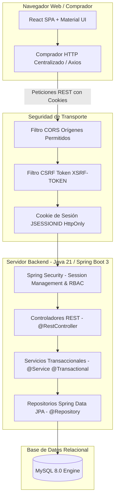

# Documento: Diseño de Arquitectura del Sistema

## Metadatos
* **Nombre:** 01_diseno_arquitectura.md
* **Descripción:** Especificación técnica y arquitectónica del sistema de inventario para ferretería: arquitectura tradicional por capas, separación en dos repositorios, comunicación HTTP REST y justificación de decisiones.
* **Fecha de creación:** 13 de octubre de 2026
* **Fecha de última actualización:** 13 de octubre de 2026
* **Autor:** Agente de IA (Arquitecto de Software)
* **Versión:** 1.0
* **Estado:** Borrador (En revisión)

---

## 1. Objetivo del Documento
Definir la arquitectura global del sistema web de gestión de inventario para una ferretería de sede única, asegurando la separación clara de responsabilidades, la integridad transaccional del inventario, la seguridad en la autenticación por sesiones y el desacoplamiento entre el backend Spring Boot y el frontend React.

---

## 2. Decisiones Arquitectónicas Confirmadas
1. **Patrón Arquitectónico Backend:** Arquitectura tradicional por capas:
   $$\text{Controller} \longrightarrow \text{Service} \longrightarrow \text{Repository} \longrightarrow \text{Database (MySQL)}$$
   * *Exclusiones expresas:* Queda prohibido el uso de Microservicios, Arquitectura Hexagonal (puertos y adaptadores), Clean Architecture pura, CQRS, Kafka, Redis y Event Sourcing.
2. **Estrategia de Repositorios:** Dos repositorios independientes:
   * `backend/`: API REST construida con Java 21, Spring Boot 3 y Spring Data JPA.
   * `frontend/`: Aplicación Single Page Application (SPA) construida con React, Material UI (MUI), Formik y Yup.
   * *Prohibido:* Unificar en un monorepo mixto con herramientas de build compartidas.
3. **Comunicación y Contratos:**
   * Comunicación vía protocolo HTTP/HTTPS utilizando verbos semánticos REST (GET, POST, PUT, PATCH, DELETE).
   * Intercambio exclusivo en formato JSON.
   * Manejo estandarizado de errores mediante **RFC 9457** (`ProblemDetail`).
4. **Seguridad y Estado de Autenticación:**
   * Autenticación basada en **Sesión de Servidor (Stateful Session)** gestionada por Spring Security.
   * Identificador de sesión transmitido mediante cookies `JSESSIONID` (`HttpOnly`, `SameSite`).
   * Prohibido el uso de tokens JWT y de autenticación stateless.
   * Protección obligatoria contra **CSRF** mediante el repositorio `CookieCsrfTokenRepository`.
5. **Persistencia de Datos:**
   * Motor relacional **MySQL 8.0**.
   * Gestión de esquema mediante scripts SQL versionados y aplicados manualmente (`01_schema.sql`, etc.).
   * Prohibido el uso de herramientas automáticas de migración (Flyway, Liquibase) y de `ddl-auto=update` en producción.

---

## 3. Diagrama de Arquitectura General

---

## 4. Responsabilidades por Capa en el Backend

* **Capa Controlador (`controller`):**
  * Responsable exclusiva de recibir peticiones HTTP, deserializar el payload entrante, invocar las validaciones declarativas de Jakarta Bean Validation (`@Valid`), delegar la ejecución a la capa de servicio y serializar la respuesta HTTP adecuada.
  * *Regla:* Los controladores **no contienen reglas de negocio** ni acceden directamente a repositorios JPA.
* **Capa de Servicio (`service`):**
  * Responsable de orquestar los casos de uso, coordinar las transacciones de base de datos (`@Transactional`), verificar las reglas de negocio (ej. validación de stock disponible, recálculo del Costo Promedio Ponderado, registro de Kárdex) y disparar eventos de auditoría.
  * *Regla:* Los servicios retornan objetos de dominio o DTOs; **nunca retornan objetos `ResponseEntity`**.
* **Capa de Repositorio (`repository`):**
  * Responsable de la abstracción del acceso a datos mediante Spring Data JPA y consultas JPQL/Nativas optimizadas con bloqueos de concurrencia requeridos.
* **Capa de Entidades (`entity`):**
  * Mapeo objeto-relacional (ORM) de las tablas de MySQL mediante anotaciones JPA/Hibernate.
* **Capa de Seguridad (`security`):**
  * Configuración de la cadena de filtros de Spring Security (`SecurityFilterChain`), gestión del ciclo de vida de la sesión, configuración de cookies, protección CSRF y filtros de autorización RBAC (`ROLE_ADMINISTRADOR`, `ROLE_USUARIO_OPERATIVO`).
* **Capa Compartida (`shared`):**
  * `shared/exception`: Manejador global de excepciones con `@RestControllerAdvice` produciendo `ProblemDetail` (RFC 9457).
  * `shared/audit`: Interceptor o servicio transversal para el registro persistente de auditoría.

---

## 5. Comunicación entre Repositorios y Despliegue
* En desarrollo local:
  * Backend: `http://localhost:8080/api/v1`
  * Frontend: `http://localhost:5173`
  * CORS habilitado específicamente para el origen `http://localhost:5173` con `allowCredentials(true)`.
* En despliegue de demostración:
  * Backend en servicio PaaS administrado gratuito (ej. Render / Railway).
  * Frontend en plataforma estática gratuita (ej. Vercel / Netlify / Render Static).
  * Orígenes restringidos explícitamente mediante variables de entorno `APP_CORS_ALLOWED_ORIGINS`.

---

## 6. Justificación Técnica de Decisiones
* **¿Por qué sesiones y no JWT?** Porque la aplicación es un sistema web cerrado para una ferretería de sede única. Las sesiones gestionadas por el contenedor de Spring Security ofrecen invalidación instantánea en el servidor ante cierre de sesión, menor superficie de ataque contra robo de tokens en LocalStorage y cumplimiento estricto del requerimiento aprobado.
* **¿Por qué MySQL sin Flyway/Liquibase?** Porque reduce dependencias externas innecesarias para una demostración académica, permitiendo que los scripts SQL versionados sean revisados y ejecutados manualmente con total visibilidad pedagógica.
