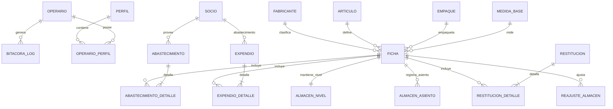

# Documento: Modelo Entidad-Relación y Estructura de Datos

## Metadatos
* **Nombre:** 02_modelo_entidad_relacion.md
* **Descripción:** Especificación técnica del modelo entidad-relación, entidades conceptuales, relaciones, cardinalidades, restricciones de integridad y reglas de persistencia para el sistema de inventario.
* **Fecha de creación:** 13 de octubre de 2026
* **Fecha de última actualización:** 13 de octubre de 2026
* **Autor:** Agente de IA (Arquitecto de Software y Modelador de Datos)
* **Versión:** 1.0
* **Estado:** Borrador (En revisión)

---

## 1. Descripción General del Modelo
El modelo de datos ha sido diseñado para soportar las operaciones de una ferretería de sede única garantizando:
1. **Separación entre Saldo y Movimientos:** Una entidad de saldo rápido (`almacen_nivel`) para validaciones de concurrencia y un registro inmutable de transacciones (`almacen_asiento`) para el Kárdex.
2. **Conservación de Costos Históricos:** En la entidad `expendio_detalle` se preserva el atributo `coste_congelado_individual` correspondiente al CPP en el momento exacto de la venta.
3. **Catálogo Normalizado:** La referencia comercializable (`ficha`) se compone de la relación entre `articulo`, `fabricante`, `empaque` y `medida_base`, contando con un código de barras único en todo el catálogo.
4. **Terceros Unificados:** Una única tabla `socio` para clientes y proveedores identificados por su documento fiscal único (NIT o Cédula).

---

## 2. Diagrama Entidad-Relación (Mermaid)

El diagrama fuente en sintaxis Mermaid se encuentra respaldado en el archivo `02_modelo_entidad_relacion.mmd`.

---

## 3. Entidades Principales y Cardinalidad

### 3.1 Identidad y Seguridad
* **`operario` (1) ── (N) `operario_perfil` (N) ── (1) `perfil`:** Relación muchos a muchos para representar la asignación de roles (`ROLE_ADMINISTRADOR`, `ROLE_USUARIO_OPERATIVO`).

### 3.2 Catálogo
* **`articulo` (1) ── (N) `ficha`:** Un producto genérico (ej. "Tornillo de Ensamble") puede tener múltiples referencias comerciales.
* **`fabricante` (1) ── (N) `ficha`:** Una marca clasifica varias referencias vendibles.
* **`empaque` (1) ── (N) `ficha`:** Forma de empaque comercial (ej. "Caja x 100", "Bolsa x 1kg", "Galón", "Unidad").
* **`medida_base` (1) ── (N) `ficha`:** Unidad base física de inventario (ej. "UND", "MTR", "KGM", "GLN").
* **Restricción de Unicidad:** `codigo_ean` es único a nivel de catálogo. La tupla `(articulo_id, fabricante_id, empaque_id)` debe ser única.

### 3.3 Inventario y Kárdex
* **`ficha` (1) ── (1) `almacen_nivel`:** Cada referencia tiene exactamente un registro de saldo con su cantidad disponible y su costo promedio ponderado vigente.
* **`ficha` (1) ── (N) `almacen_asiento`:** Historial cronológico inmutable de entradas y salidas.

### 3.4 Compras
* **`socio` (1) ── (N) `abastecimiento`:** Cada compra se asigna obligatoriamente a un tercero con `es_suministrador = true`.
* **`abastecimiento` (1) ── (N) `abastecimiento_detalle`:** Cada compra tiene 1 o más líneas.

### 3.5 Ventas y Devoluciones
* **`socio` (1) ── (N) `expendio`:** Cada venta se asigna obligatoriamente a un tercero con `es_comprador = true` (RN-05).
* **`expendio` (1) ── (N) `expendio_detalle`:** Cada venta tiene 1 o más líneas.
* **`expendio` (0..1) ── (N) `restitucion`:** Una venta puede originar cero o múltiples devoluciones parciales (o devoluciones no vinculadas sin venta).

---

## 4. Reglas de Integridad y Eliminación de Datos

1. **Protección contra Borrado Físico (RN-02):**
   * Las tablas `ficha`, `articulo`, `fabricante`, `empaque` y `socio` cuentan con la columna booleana `habilitado`.
   * Si una referencia posee transacciones en `almacen_asiento`, `expendio_detalle` o `abastecimiento_detalle`, la base de datos restringe el borrado físico (`ON DELETE RESTRICT`). Para retirar la referencia del catálogo se actualiza `habilitado = false`.
2. **Inmutabilidad del Kárdex:**
   * La tabla `almacen_asiento` es estrictamente de inserción (`INSERT-only`). No se permiten sentencias `UPDATE` ni `DELETE` sobre registros históricos.
3. **Control de Consecutivos:**
   * La tabla `tiquete_correlativo` almacena el último número generado para cada tipo de documento (`EXPENDIO`, `ABASTECIMIENTO`, `RESTITUCION`, `REAJUSTE`) asegurando numeración correlativa mediante incremento atómico.
