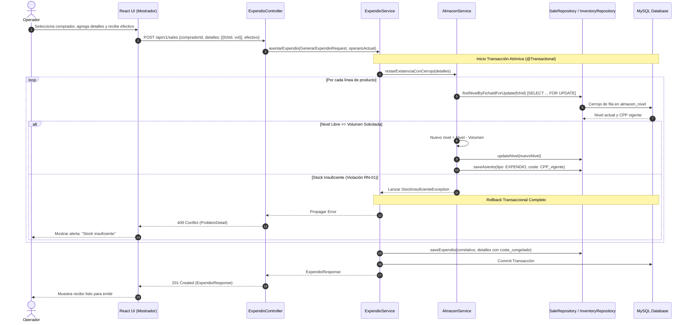
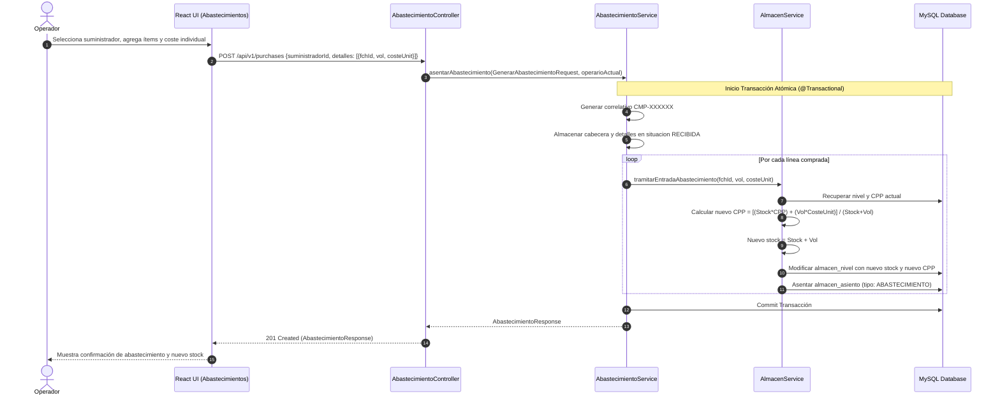
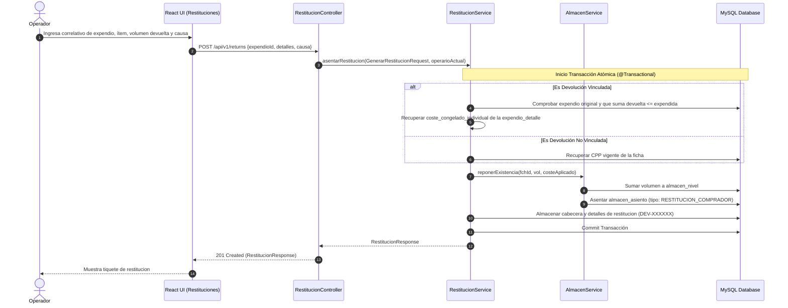
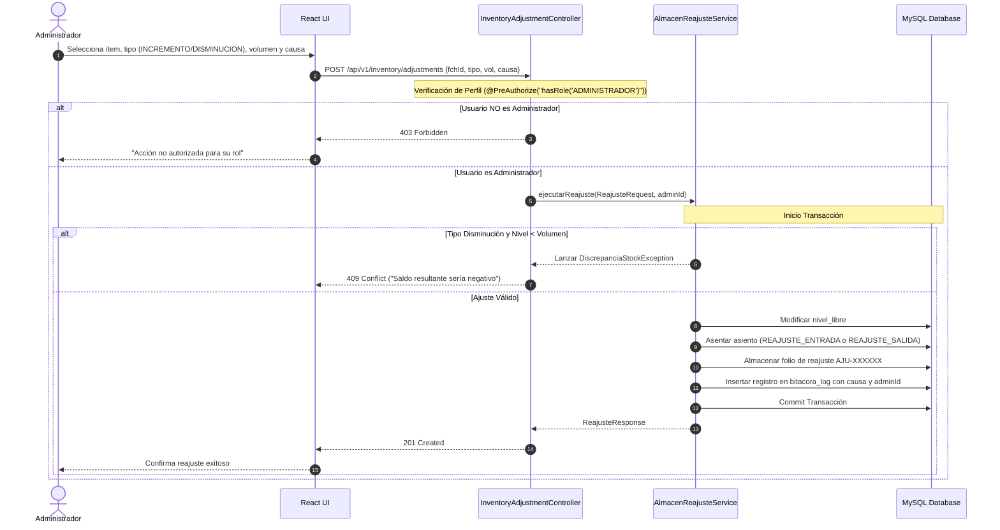
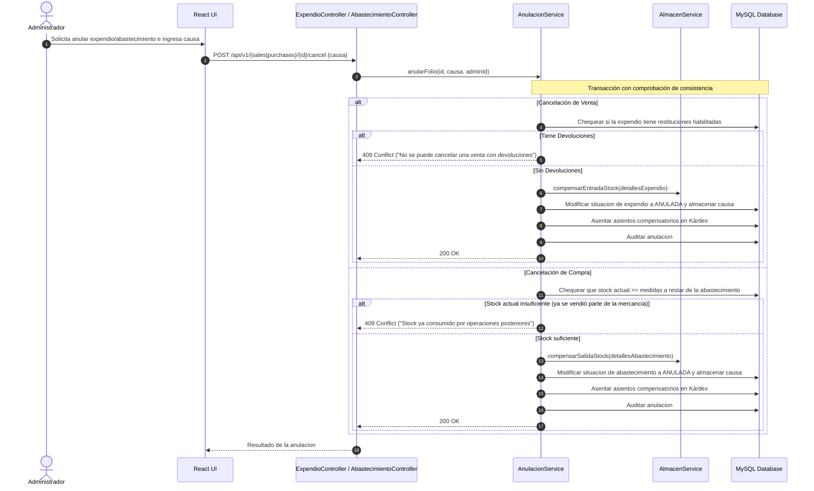

# Documento: Diagramas de Secuencia de Procesos Críticos

## Metadatos
* **Nombre:** 05_diagramas_secuencia.md
* **Descripción:** Diagramas de secuencia en formato Mermaid y explicación técnica para los flujos críticos: login, compra, venta, devolución, ajuste y cancelaciones.
* **Fecha de creación:** 13 de octubre de 2026
* **Fecha de última actualización:** 13 de octubre de 2026
* **Autor:** Agente de IA (Arquitecto de Software)
* **Versión:** 1.0
* **Estado:** Borrador (En revisión)

---

## 1. Diagrama de Secuencia: Inicio de Sesión (Login)

```mermaid
sequenceDiagram
    autonumber
    actor Usuario
    participant Frontend as React Frontend
    participant Filter as SecurityFilterChain
    participant AuthMgr as AuthenticationManager
    participant UserDetails as CustomUserDetailsService
    participant Session as HttpSession / SecurityContext

    Operario->>Frontend: Ingresa operario y contraseña
    Frontend->>Filter: POST /api/v1/auth/login {username, password}
    Filter->>AuthMgr: authenticate(UsernamePasswordAuthenticationToken)
    AuthMgr->>UserDetails: loadUserByUsername(username)
    UserDetails-->>AuthMgr: UserDetails (con BCrypt hash y perfiles)
    AuthMgr->>AuthMgr: PasswordEncoder.matches(raw, hash)
    
    alt Credenciales Válidas
        AuthMgr-->>Filter: Authentication (Authenticated)
        Filter->>Session: Almacenar SecurityContext en sesión
        Filter-->>Frontend: 200 OK + Set-Cookie: JSESSIONID; HttpOnly; SameSite=Lax
        Frontend->>Frontend: Almacenar datos de operario en SesionContext
        Frontend-->>Operario: Redirige al Dashboard
    else Credenciales Inválidas
        AuthMgr-->>Filter: BadCredentialsException
        Filter-->>Frontend: 401 Unauthorized (RFC 9457 ProblemDetail)
        Frontend-->>Operario: Muestra mensaje de error
    end
```

---

## 2. Diagrama de Secuencia: Registro de Venta de Contado (Concurrencia y Kárdex)



---

## 3. Diagrama de Secuencia: Registro de Compra Completa y Recálculo de Costo Promedio (CPP)



---

## 4. Diagrama de Secuencia: Devolución de Cliente y Reincorporación de Stock



---

## 5. Diagrama de Secuencia: Ajuste Manual de Inventario (Solo Administrador)



---

## 6. Diagrama de Secuencia: Cancelación de Compra o Venta


